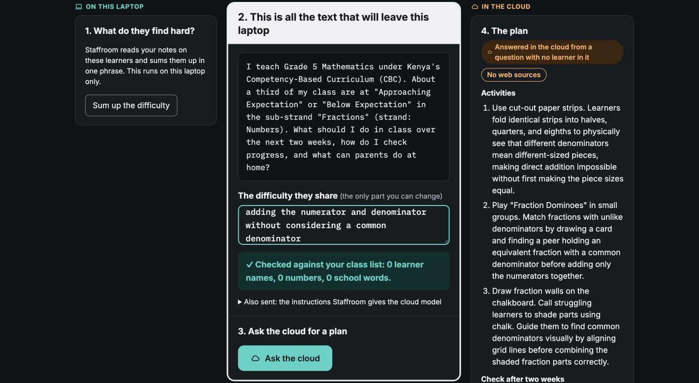
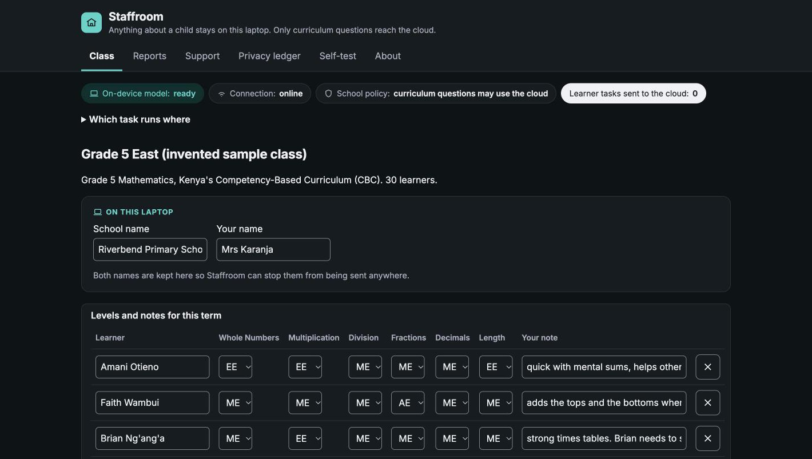
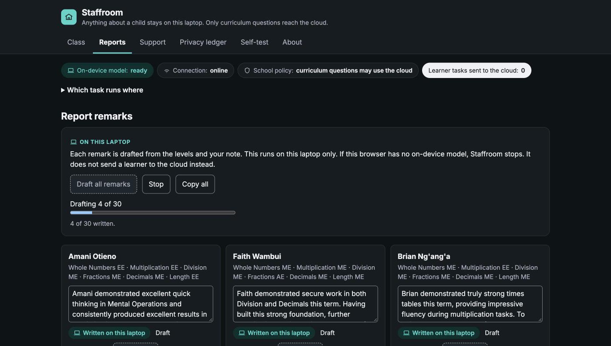
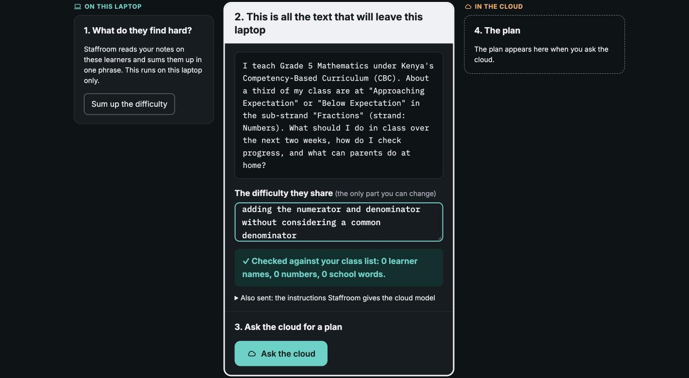
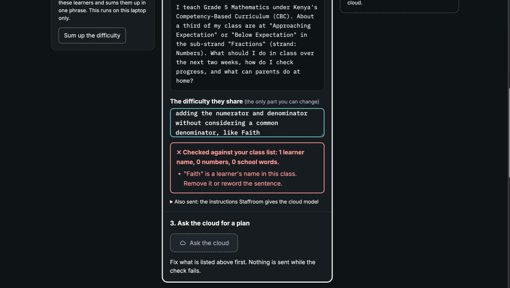
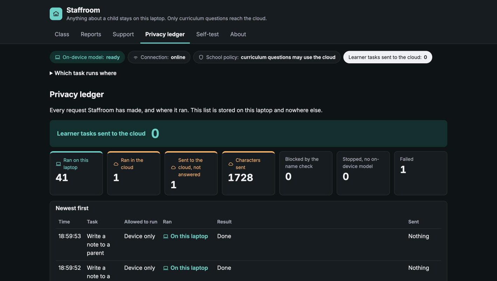
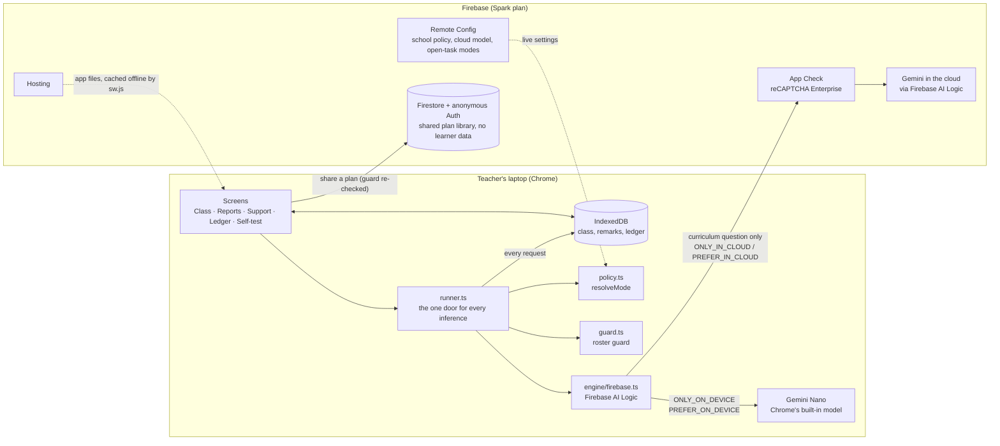

# Staffroom

**A term-end desk for class teachers where anything about a child stays on the laptop, and only curriculum questions reach the cloud.**

Staffroom helps a class teacher finish end-of-term reports. The teacher enters each learner's levels and a short note. Staffroom drafts every report remark, finds the groups that are struggling with the same topic, asks the cloud for a remedial plan for each group, and writes a note to each parent. Remarks, group summaries and parent notes are written by Gemini Nano inside Chrome, on the teacher's own laptop. The only text that leaves is a curriculum question with no learner in it, which the teacher reads before it is sent.

- **Live demo:** https://staffroom-88e70.web.app (no login; use the invented sample class)
- **Built for:** #BuildHybridAI 2026 (Firebase AI Logic hybrid inference), Web/Chrome
- **Curriculum pack:** Kenya's CBC, Grade 5 Mathematics



## The rule

> A task that touches learner data runs on the device or not at all.

Most hybrid apps fall back to the cloud when the device can't run a prompt. For a child's data, that fallback is a leak. Staffroom refuses instead, says why, and logs every request in a ledger on the laptop.

The rule is enforced by code in five places:

1. **[`src/core/policy.ts`](src/core/policy.ts), `resolveMode`:** the only place that decides a task's mode. A task that touches learner data resolves to `ONLY_ON_DEVICE` under every setting. Remote Config can change the modes of the other tasks, never these.
2. **[`src/core/runner.ts`](src/core/runner.ts):** every inference goes through one runner. A request that could reach the cloud must carry an outbound message, its prompt must equal the text that was checked, and the roster guard must pass, or the engine is never called.
3. **[`src/core/runner.ts`](src/core/runner.ts):** if the engine reports a cloud run for an on-device-only request, the result is thrown away and the attempt is logged.
4. **[`src/engine/firebase.ts`](src/engine/firebase.ts):** an on-device-only model is created with no cloud settings at all.
5. **[`src/store/store.ts`](src/store/store.ts):** the only file that reads learner data (IndexedDB) has no network code.

Names never enter a prompt, even on the device: prompts say `[NAME]` and code fills the name in afterwards.

## Which task runs where

Seven tasks use all four hybrid inference modes.

| Task | Learner data? | Mode | Why |
|---|---|---|---|
| Draft a report remark | Yes | `ONLY_ON_DEVICE` | Holds a learner's levels and the teacher's note. |
| Sum up a group's common difficulty | Yes | `ONLY_ON_DEVICE` | Reads the teacher's notes on several learners. |
| Write a note to a parent | Yes | `ONLY_ON_DEVICE` | Joins the plan to one learner's levels and note. |
| Read a mark-sheet photo | Yes | `ONLY_ON_DEVICE` | The photo shows names and levels. (Prompt, schema and parser exist; no screen in this version.) |
| Ask for a remedial plan | No | `ONLY_IN_CLOUD` | Needs curriculum knowledge and web sources. The small model can't be trusted for facts. |
| Suggest a starter activity | No | `PREFER_IN_CLOUD` | Better from the cloud, still useful offline from the device. |
| Put a level into plain words | No | `PREFER_ON_DEVICE` | Simple rewording. Free on the device, and harmless if it falls back. |

Every result shows where it ran, from the SDK's own `inferenceSource`.

## Try it in three minutes

You need desktop Chrome with the built-in model. On my MacBook Air M2 with Chrome 157 (stable), the model was available on the live site with no flag. Without it, the open tasks still work through the cloud and the learner tasks stop with an explanation; that is the intended behaviour.

1. Open https://staffroom-88e70.web.app. On **Class**, choose "Load the invented sample class". Thirty made-up learners appear with levels and notes.
2. Turn your wifi off.
3. On **Reports**, choose "Draft all remarks". Each remark says "Written on this laptop".
4. On **Support**, Fractions is first, with 10 learners. Choose "Plan support", then "Sum up the difficulty". The laptop reads their notes and writes one phrase.
5. Turn your wifi back on. Read the text that will leave the laptop, checked against the class list. Choose "Ask the cloud".
6. The plan comes back with activities for the group. Web sources aren't available on the free tier this demo runs on, so Staffroom offers to ask again without them and marks the answer "No web sources".
7. Choose "Write the parent notes". One note per learner is written on the laptop.
8. Type a learner's first name, such as "Faith", into the difficulty. "Ask the cloud" switches off and says why. Nothing is sent.
9. Open the **Privacy ledger**. Every request is there, with where it ran and, for the cloud, the exact text sent.

The **Self-test** tab runs one request per task and shows the mode and where each one ran.

## Screenshots

Taken on the live site in my Chrome 157, with the real on-device model and the invented sample class.

**1. Class.** The invented sample class: 30 made-up learners with levels and notes, stored in this browser only.



**2. Reports, mid-batch.** Each remark is drafted on the laptop and says so.



**3. The outbound preview, passing.** This is all the text that will leave the laptop, checked against the class list: 0 learner names.



**4. The same preview, blocking a name.** A learner's name in the difficulty switches "Ask the cloud" off and says why. Nothing is sent.



**5. The plan.** The cloud answers the curriculum question. On the free tier there are no web sources, and the plan says so.


**6. The Privacy ledger.** Every request, where it ran and what was sent. This run: 41 on the laptop, 1 in the cloud, 1 sent and not answered, 0 learner tasks sent to the cloud.



## Architecture



## How Firebase AI Logic is called

- **[`src/engine/firebase.ts`](src/engine/firebase.ts), class `FirebaseEngine`:** maps each task's mode to `InferenceMode` and calls `getGenerativeModel(ai, { mode, onDeviceParams, inCloudParams })`, then `generateContent`. On-device requests use structured output (a JSON schema) where the task needs it. The plan asks for Grounding with Google Search (`tools: [{ googleSearch: {} }]`). Cloud requests stop waiting after 30 seconds and are logged as sent, with their exact text.
- **[`src/firebase/services.ts`](src/firebase/services.ts), `startFirebase`:** App Check with reCAPTCHA Enterprise, Remote Config with a realtime listener (a change applies with no reload), anonymous Auth, and the Firestore plan library.
- **[`src/core/flows.ts`](src/core/flows.ts):** `draftRemark`, `summariseDifficulty`, `askPlan`, `writeParentNote`. Every prompt, schema and parser is in [`src/core/prompts.ts`](src/core/prompts.ts).
- **Remote Config keys** ([`remoteconfig.template.json`](remoteconfig.template.json)): `school_policy` (`standard`, or `strict`: nothing leaves the laptop), `cloud_model`, `task_modes` (ignored for learner-data tasks).

## The roster guard

[`src/core/guard.ts`](src/core/guard.ts) is plain code, no model. Before any text can leave, `checkOutbound` compares it with the class list and refuses:

- learner names, including names written without accents or apostrophes ("Ng'ang'a" and "NGANGA" match), and full names run together;
- admission numbers, the school's name and other terms that point at this class;
- long runs of digits, email addresses and dates.

The outbound message has two parts: a fixed part built only from the curriculum pack, and a free part the model or the teacher wrote, which is checked strictly. The teacher sees both in the outbound preview, and every edit is checked again. A shared plan is checked again before it is saved.

**What it can't catch:** a nickname or misspelling it has never seen. That is why the teacher reads the text before sending it.

## What I measured

On a MacBook Air M2 (8 GB RAM), macOS 27, Chrome 157 stable, with the real Firebase engine. Full notes in [`docs/test-log.md`](docs/test-log.md).

- **Remarks:** 30 of 30 written on the laptop. Median 4.1 s per remark once the model is warm. 27 of 30 usable without editing, by my reading. On the live site the batch of 30 took about 90 s.
- **No network while remarks are written:** with wifi on, an in-page observer saw 0 requests during the batch of 30 (about 130 s). The page does make background requests when idle (reCAPTCHA checks and the Remote Config stream), so I don't claim "no network at all".
- **Parent notes:** 10 of 10 for the Fractions group, in about 20 s.
- **Difficulty phrase:** on topic in 3 of 3 runs for Fractions on the live site, about 1.3 s each after the first run of a session.
- **The whole loop on the live site** (incognito, wifi off for the on-device steps): 41 runs on the laptop, 1 in the cloud, 1 sent and not answered (the plan with web sources, refused by the free tier), 1,700 characters sent in all, **0 learner tasks sent to the cloud**.
- **With no on-device model (Safari):** the learner tasks stopped with "Did not run", the open tasks ran in the cloud, and 0 learner tasks were sent to the cloud.

## Limitations

- Desktop Chrome only. Android, iOS and other browsers are not supported in this version.
- English only for writing on the laptop.
- The on-device model needs a capable laptop, which many teachers don't have.
- The name check can't catch a nickname or misspelling it has never seen.
- What is stored on the laptop is not encrypted. Anyone using the same browser profile can see it.
- Every remark, plan and note is a draft. The teacher reads, edits and decides.
- On the free tier this demo runs on, plans come without web sources.
- Reading a mark-sheet photo has no screen in this version.
- One class and one learning area at a time. No printing of a full report card.
- `npm audit` reports 4 high-severity issues, all inside `firebase@13.3.0` (through `@grpc/grpc-js`). `npm audit fix --force` would change the Firebase version, so I haven't run it.

## Privacy

Staffroom keeps your class in this browser, on this laptop. Remarks, group summaries and parent notes are written by a model that runs inside Chrome on the same laptop. One kind of text can leave: a curriculum question with no learner in it, which you see and can edit before it is sent. If you share a plan, that question and the cloud's answer are saved to a shared library that other teachers using Staffroom can read. Staffroom has no accounts with names, no analytics, and no copy of your class on any server. It does not encrypt what is stored on the laptop.

Staffroom relies on Chrome running the built-in model on the device, as Google says it does; it shows the SDK's own `inferenceSource` for every run. Running on the laptop reduces where a child's data goes. It doesn't remove a school's duties under Kenya's Data Protection Act, such as a parent's or guardian's consent. This is not legal advice.

## Run it locally

Requirements: Node 24 (the version I tested with) and desktop Chrome.

```bash
npm install
npm run dev         # http://localhost:5173
```

With no `.env.local`, or with `?engine=demo` in the address, the app uses a **simulated engine** and says so in a yellow banner. It calls no model, so the screens and routing can be tried anywhere. Other switches for the simulated engine:

| Add to the address | Pretends |
|---|---|
| `&device=unavailable` | the browser has no on-device model |
| `&offline=1` | the cloud can't be reached |
| `&grounding=refused` | the cloud refuses the plan with web sources |
| `&cloud=slow` | the cloud doesn't answer in time |
| `&library=demo` / `&library=down` | the shared plan library has a plan / is down |
| `&policy=strict` | the school's strict policy is on |

**To use the real engine** with your own Firebase project:

1. Create a Firebase project and a web app. Copy `.env.example` to `.env.local` and fill in the web app's config.
2. In Firebase AI Logic, enable the Gemini Developer API.
3. In App Check, register the web app with a reCAPTCHA Enterprise key that lists your domains, and put the site key in `.env.local`. On localhost, register the debug token the console prints and add it to `.env.local` (never commit it; the build fails if it reaches `dist/`).
4. Enable anonymous sign-in in Authentication, and create a Firestore database.
5. Deploy the rules and the Remote Config template, then the site:

```bash
firebase deploy --only firestore,remoteconfig --project <your-project-id>
```

```bash
npm run build && firebase deploy --only hosting --project <your-project-id>
```

## Tests

```bash
npm run typecheck
npm test            # 136 unit tests (Vitest)
npm run e2e         # build, then 142 browser checks in headless Chrome
```

`npm run e2e` uses the Chrome installed on your computer. If it can't find it, set `CHROME_PATH` to the Chrome binary.

The unit tests cover the guard, the mode policy, the runner, the prompts and parsers, the plan library and the Firebase engine's handling of the SDK's answers. The browser checks walk every screen with the simulated engine, including the keyboard-only path, offline, no on-device model, a refused or slow cloud and the strict policy.

**What the simulated engine doesn't prove:** the quality of the real model's writing, its speed, or that Chrome really runs it on the device. Those come from runs on the real model, recorded in [`docs/test-log.md`](docs/test-log.md).

## Credits

Made by Gregory Temwa Odete in Nairobi. Built with Firebase AI Logic (hybrid inference with Gemini Nano in Chrome and Gemini in the cloud), App Check, Remote Config, Firestore, Authentication and Hosting, plus React, Vite and TypeScript. Fonts: Inter and IBM Plex Mono (SIL Open Font License).

Every learner, number and note in the sample class is invented.

## AI assistance

Claude (Anthropic) wrote most of this code under my direction, from the starter (core modules, first screens, tests, build script) to the later screens, prompts and tests. Claude also helped me research the hackathon and design the routing rules. I set the rules, reviewed every pull request, tuned the prompts on the real on-device model and ran every real-device test in this README. Everything was built during the submission period, from 16 Nov 2026.

## Licence

Apache 2.0. See [`LICENSE`](LICENSE).
